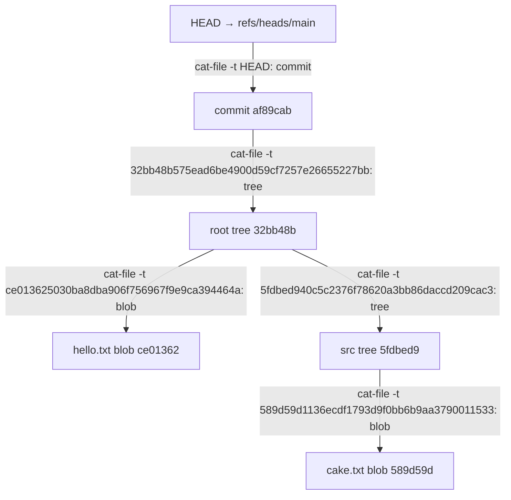

# Explore Git internals with minigit

First follow the [quick start](index.md#quick-start) to clone and install
minigit. Activate that virtual environment before starting the tour: it puts
`minigit` on your `PATH`. This session uses `tree` to show folders; you can
also open them in a file browser. Turn on **Show hidden files** so `.minigit`
is visible.

I ran every command below in a scratch folder outside the source checkout.
Commands with no output go straight to the next prompt. The fixed dates make
the commit SHAs reproducible. Your path may differ; SHAs change if file bytes,
author, time, message, or parent differ. For the same bytes, the blob SHA stays
the same.

## 1. Start an empty repo

```console
$ mkdir /tmp/minigit-internals-20b
$ cd /tmp/minigit-internals-20b
$ export MINIGIT_AUTHOR_NAME=Ada MINIGIT_AUTHOR_EMAIL=ada@example.com MINIGIT_AUTHOR_DATE='1791936000 +0000'
$ minigit init
Initialized empty minigit repository in /tmp/minigit-internals-20b/.minigit
$ tree -L 1 .minigit
.minigit
├── HEAD
├── config
├── objects
└── refs

3 directories, 2 files
$ cat .minigit/HEAD
ref: refs/heads/main
```

Open `.minigit` in your file browser. `objects/` and `refs/heads/` are empty.
`HEAD` says which branch you're on, but `refs/heads/main` won't exist until
there's a commit to point at.

## 2. Hash a file, then stage two files

```console
$ printf "hello\n" > hello.txt
$ minigit hash-object hello.txt
ce013625030ba8dba906f756967f9e9ca394464a
$ tree -L 1 .minigit/objects
.minigit/objects

0 directories, 0 files
$ minigit hash-object -w hello.txt
ce013625030ba8dba906f756967f9e9ca394464a
$ tree -L 2 .minigit/objects
.minigit/objects
└── ce
    └── 013625030ba8dba906f756967f9e9ca394464a

2 directories, 1 file
$ mkdir src
$ printf "the cake is not a lie\n" > src/cake.txt
$ minigit add hello.txt src/cake.txt
$ cat .minigit/minigit-index
minigit-index 1
100644 ce013625030ba8dba906f756967f9e9ca394464a hello.txt
100644 589d59d1136ecdf1793d9f0bb6b9aa3790011533 src/cake.txt
$ tree -L 2 .minigit/objects
.minigit/objects
├── 58
│   └── 9d59d1136ecdf1793d9f0bb6b9aa3790011533
└── ce
    └── 013625030ba8dba906f756967f9e9ca394464a

3 directories, 2 files
$ minigit cat-file -t ce013625030ba8dba906f756967f9e9ca394464a
blob
$ minigit cat-file -p ce013625030ba8dba906f756967f9e9ca394464a
hello
$ minigit cat-file -t 589d59d1136ecdf1793d9f0bb6b9aa3790011533
blob
$ minigit cat-file -p 589d59d1136ecdf1793d9f0bb6b9aa3790011533
the cake is not a lie
```

`hash-object` first calculated a SHA without storing anything. `-w` wrote the
blob. In the file browser, its SHA is split into a two-character directory
and a 38-character filename. The files inside `objects/` are compressed, so
use `cat-file -t` to identify them and `cat-file -p` to read them. `add` wrote
the second blob and put both paths in `minigit-index`, the plain-text staging
list. The index is not a commit or an object.

## 3. Commit, then follow the pointers

```console
$ minigit commit -m "First snapshot"
[main (root-commit) af89cab] First snapshot
$ tree -L 2 .minigit/refs
.minigit/refs
├── heads
│   └── main
└── tags

3 directories, 1 file
$ cat .minigit/refs/heads/main
af89caba20e98ac0f7e5219a54a5cc17fd2ad417
$ minigit cat-file -t HEAD
commit
$ minigit cat-file -p HEAD
tree 32bb48b575ead6be4900d59cf7257e26655227bb
author Ada <ada@example.com> 1791936000 +0000
committer Ada <ada@example.com> 1791936000 +0000

First snapshot
$ minigit cat-file -t 32bb48b575ead6be4900d59cf7257e26655227bb
tree
$ minigit cat-file -p 32bb48b575ead6be4900d59cf7257e26655227bb
100644 blob ce013625030ba8dba906f756967f9e9ca394464a	hello.txt
040000 tree 5fdbed940c5c2376f78620a3bb86daccd209cac3	src
$ minigit cat-file -t 5fdbed940c5c2376f78620a3bb86daccd209cac3
tree
$ minigit cat-file -p 5fdbed940c5c2376f78620a3bb86daccd209cac3
100644 blob 589d59d1136ecdf1793d9f0bb6b9aa3790011533	cake.txt
```

Refresh `.minigit/refs/heads/` and `.minigit/objects/` in your file browser.
There is now a branch ref, a commit, two trees, and two blobs. `HEAD` follows
`main`; `main` holds the commit SHA. The first commit has no `parent` line.
Follow its `tree` line to the root directory, then the `src` entry to the
nested directory, then the `cake.txt` entry to its blob.



## 4. Change one line and inspect every parent

Remove just `not ` from the nested file. The new blob SHA is different even
though the edit is small:

```console
$ printf "the cake is a lie\n" > src/cake.txt
$ minigit hash-object src/cake.txt
13297334b178e361b0da9b3a0e91c0937fe6cfd2
$ minigit add src/cake.txt
$ cat .minigit/minigit-index
minigit-index 1
100644 ce013625030ba8dba906f756967f9e9ca394464a hello.txt
100644 13297334b178e361b0da9b3a0e91c0937fe6cfd2 src/cake.txt
$ minigit cat-file -t 13297334b178e361b0da9b3a0e91c0937fe6cfd2
blob
$ minigit cat-file -p 13297334b178e361b0da9b3a0e91c0937fe6cfd2
the cake is a lie
$ export MINIGIT_AUTHOR_DATE='1791936060 +0000'
$ minigit commit -m "Update cake"
[main d89f35b] Update cake
$ cat .minigit/refs/heads/main
d89f35b08c6e4500ecb29e2af2e6c00f299215de
$ minigit cat-file -t HEAD
commit
$ minigit cat-file -p HEAD
tree cde732c8de4ade021c1f9af3e0bfc11fcf32ccbf
parent af89caba20e98ac0f7e5219a54a5cc17fd2ad417
author Ada <ada@example.com> 1791936060 +0000
committer Ada <ada@example.com> 1791936060 +0000

Update cake
$ minigit cat-file -t cde732c8de4ade021c1f9af3e0bfc11fcf32ccbf
tree
$ minigit cat-file -p cde732c8de4ade021c1f9af3e0bfc11fcf32ccbf
100644 blob ce013625030ba8dba906f756967f9e9ca394464a	hello.txt
040000 tree e3d012b348d442bc07955cc04c5dea5f29d70125	src
$ minigit cat-file -t e3d012b348d442bc07955cc04c5dea5f29d70125
tree
$ minigit cat-file -p e3d012b348d442bc07955cc04c5dea5f29d70125
100644 blob 13297334b178e361b0da9b3a0e91c0937fe6cfd2	cake.txt
```

Compare each SHA from the first and second snapshots:

| What changed? | First snapshot | Second snapshot |
|---|---|---|
| `src/cake.txt` blob | `589d59d` | `1329733` |
| `src` tree | `5fdbed9` | `e3d012b` |
| root tree | `32bb48b` | `cde732c` |
| commit | `af89cab` | `d89f35b` |
| `hello.txt` blob | `ce01362` | `ce01362` |

A tree stores the SHAs of its children. The changed blob required a new
`src` tree; its new SHA then required a new root tree. In a deeper path, this
continues through every directory up to the root. The unchanged `hello.txt`
blob was reused. The second commit points back to the first through `parent`,
and `refs/heads/main` now points to the second commit.

Finally, refresh the file browser to see that the old objects are still there:

```console
$ tree -L 2 .minigit/objects
.minigit/objects
├── 13
│   └── 297334b178e361b0da9b3a0e91c0937fe6cfd2
├── 32
│   └── bb48b575ead6be4900d59cf7257e26655227bb
├── 58
│   └── 9d59d1136ecdf1793d9f0bb6b9aa3790011533
├── 5f
│   └── dbed940c5c2376f78620a3bb86daccd209cac3
├── af
│   └── 89caba20e98ac0f7e5219a54a5cc17fd2ad417
├── cd
│   └── e732c8de4ade021c1f9af3e0bfc11fcf32ccbf
├── ce
│   └── 013625030ba8dba906f756967f9e9ca394464a
├── d8
│   └── 9f35b08c6e4500ecb29e2af2e6c00f299215de
└── e3
    └── d012b348d442bc07955cc04c5dea5f29d70125

10 directories, 9 files
```

Those nine files are three blobs, four trees, and two commits. To see how
minigit writes them, continue with the [architecture guide](ARCHITECTURE.md).
